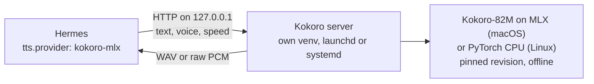

# hermes-kokoro-tts

Local [Kokoro](https://huggingface.co/hexgrad/Kokoro-82M) text-to-speech for [Hermes Agent](https://hermes-agent.nousresearch.com/docs/) on Apple Silicon and Linux. Hermes speaks with a natural voice in Brazilian Portuguese and English, and in Italian (not yet tested by the author), sentence by sentence as the reply streams, and the text never leaves your machine.

- **Native Hermes TTS provider**: set `tts.provider: kokoro-mlx` and every surface that speaks (Desktop read-aloud, voice mode, wake word, `text_to_speech`) uses it.
- **Streaming**: raw PCM per sentence, so the first words play while the rest of the reply is still being written.
- **A voice per language**: each sentence is spoken by the voice of its language, Brazilian Portuguese, English or Italian, and a dictionary makes English terms inside a Portuguese sentence sound English.
- **Isolated and offline**: the model runs in its own Python environment behind a loopback-only server. Hermes' own environment gets nothing new, and after installation nothing touches the network.
- **Pinned**: one reviewed model revision per platform. Updating it is a code change you can see.

## Requirements

- One of:
  - macOS on Apple Silicon. Kokoro runs on MLX ([mlx-audio](https://github.com/Blaizzy/mlx-audio)).
  - Linux on x86_64, with a systemd user session (`systemctl --user`). Kokoro runs on the CPU with PyTorch (the [`kokoro`](https://github.com/hexgrad/kokoro) package); no GPU is used or needed. Linux on aarch64 has every package as a binary wheel but is untested.
- Hermes Agent 0.22.2 or later (the version it is tested on).
- [`uv`](https://docs.astral.sh/uv/): `brew install uv` on macOS; on Linux `pipx install uv`, your distribution's package, or [uv's installer](https://docs.astral.sh/uv/getting-started/installation/). It also fetches Python 3.11 if you don't have it.
- About 1.5 GB of disk: ~1.1 GB (macOS) or ~1.3 GB (Linux) of Python packages and ~340 MB of model.

Nothing else is needed on Linux: espeak-ng, used for pronunciation, comes bundled in the `espeakng-loader` wheel.

## Install

```sh
hermes plugins install brunosouzas/hermes-kokoro-tts
hermes kokoro install                 # builds the server environment, downloads the model, starts it
hermes config set tts.provider kokoro-mlx
hermes kokoro say "Hello from Hermes"  # writes a test WAV and prints its path
```

`hermes kokoro install` is idempotent: run it again after an update or after changing the port.

On Linux the server is a systemd user unit, so it runs while you are logged in. To keep it running after you log out (for a Hermes gateway on a server, say), run `loginctl enable-linger` once.

**Upgrading from 0.1.0:** the provider is now called `kokoro-mlx` (it was `kokoro`). Hermes reserves the names of its built-in providers, and a built-in `kokoro` has been proposed upstream, so the plugin uses a name that cannot collide. Run `hermes config set tts.provider kokoro-mlx` once.

## Choose a voice

```sh
hermes kokoro voices                                            # what the installed model offers
hermes config set plugins.entries.kokoro-tts.settings.voice bf_emma
```

The first letter of a voice id is its language (`a` US English, `b` UK English, `p` Brazilian Portuguese, `i` Italian) and the second its gender. Some starting points: `af_heart`, `am_michael`, `bf_emma`, `bm_george`, `pf_dora`, `pm_alex`, `if_sara`, `im_nicola`.

If `tts.voice` is set in your Hermes config, it wins over the plugin setting.

### A voice per language

Kokoro reads text with the pronunciation rules of the voice's language, so English read by a Portuguese voice sounds wrong (and the other way round). Give each language its own voice and the plugin picks one per sentence:

```sh
hermes config set plugins.entries.kokoro-tts.settings.voice pf_dora          # default voice
hermes config set plugins.entries.kokoro-tts.settings.voices.pt pf_dora
hermes config set plugins.entries.kokoro-tts.settings.voices.en bf_emma
hermes kokoro install                                                        # loads both voices at start-up
```

A reply in English is spoken by `bf_emma`, one in Portuguese by `pf_dora`, and a mixed reply switches at sentence boundaries. A sentence with no clear language (a name, a number) keeps the previous voice. Detection counts common function words and accents. It is built into the plugin, needs no extra package, and tells Portuguese, English and Italian apart (for Italian, add `voices.it`, e.g. `im_nicola` or `if_sara`). A `voices` entry for any other language, or whose value is not a well-formed voice id, is ignored: `hermes kokoro install` prints a warning for it, and Hermes logs one. It works on whole sentences: an English word inside a Portuguese sentence ("o pipeline terminou") still gets the Portuguese pronunciation, because switching voices mid-sentence sounds worse than an accent. Setting `tts.voice` turns switching off.

### English words inside other languages

Switching voices fixes whole sentences, but a Portuguese sentence full of English terms ("o pipeline terminou e o card está no board") still gets those words pronounced as if they were Portuguese. Keep a dictionary of English words and the **same voice** says them in English, with no change of voice mid-sentence:

```sh
hermes kokoro words add pipeline card deploy merge board "pull request"
hermes kokoro words                      # list
hermes kokoro words remove board
hermes config set plugins.entries.kokoro-tts.settings.english_accent b   # British; default a (American)
```

No list can know in advance which words you use, so it is meant to grow: when you hear a word come out wrong, add it. Changes apply to the next reply without a restart. Matching is case-insensitive, whole-word, and also covers plurals with -s ("cards", "pull requests"). How it works: the sentence is phonemized in the voice's own language, and only the listed words get English phonemes from Kokoro's English pronunciation lexicon. A word the lexicon does not know is pronounced by espeak's English rules instead (still English, though less polished: names like "Kubernetes" usually come out fine, invented words get spelled out). If the phonemes cannot be lined up with the words, the sentence is spoken normally. The dictionary applies to non-English voices; English voices already say these words in English.

Each language loads its pronunciation pipeline the first time it is used after the server starts. The server does that at start-up for `voice` and every voice in `voices`, so run `hermes kokoro install` again after changing either. Switching to another language later costs a one-off pause: a few seconds for most languages, up to about a minute for English, which loads spaCy and PyTorch.

Tested by the author: Brazilian Portuguese and English. Italian is not yet tested by the author: its detection is checked against everyday sentences in the tests, and reports from Italian speakers are welcome.

## Settings

All under `plugins.entries.kokoro-tts.settings` (also editable in Hermes Desktop → Settings → Plugins):

| Key | Default | Meaning |
|---|---|---|
| `voice` | `af_heart` | Kokoro voice id |
| `voices` | empty | Voice per detected language, e.g. `{pt: pf_dora, en: bf_emma}` (see *A voice per language*) |
| `english_words` | empty | Words and short phrases a non-English voice says in English (see *English words inside other languages*) |
| `english_accent` | `a` | Pronunciation of `english_words`: `a` American, `b` British |
| `language` | empty | Single-voice mode: read text in another language with the same voice (`p`, `pt-br`, `e`, …). Empty = the voice's language |
| `speed` | `1.0` | 0.25 to 4.0 |
| `port` | `8770` | Loopback port of the server |
| `service_dir` | `~/Library/Application Support/hermes-kokoro-tts` (macOS), `${XDG_DATA_HOME:-~/.local/share}/hermes-kokoro-tts` (Linux) | Server environment, model cache and log |

## Commands

| Command | What it does |
|---|---|
| `hermes kokoro install` | Create or refresh the environment, download the pinned model, install and start the launchd agent `dev.hermes.kokoro-tts` (macOS) or the systemd user unit `dev.hermes.kokoro-tts.service` (Linux) |
| `hermes kokoro status` | launchd or systemd state, server health, paths |
| `hermes kokoro restart` | Restart the server |
| `hermes kokoro voices` | List installed voices |
| `hermes kokoro say "text" [--voice id]` | Synthesize a test sentence to a WAV file |
| `hermes kokoro words [list\|add\|remove] [WORD ...]` | Manage the English-words dictionary |
| `hermes kokoro uninstall [--purge]` | Stop and remove the launchd agent or systemd unit; `--purge` also deletes the environment and the model |

## What it reads, sends and writes

- **Sends** the text Hermes wants spoken to `http://127.0.0.1:<port>`, on your own machine, bypassing any `http_proxy` setting. Nothing goes to a cloud service. The server does not log the text.
- **Downloads**, during `hermes kokoro install` only: Python packages through `uv` (PyPI, plus spaCy's `en_core_web_sm` 3.8.0 wheel from its GitHub release, pinned by SHA-256; on Linux also the CPU-only `torch` wheel from `download.pytorch.org`, pinned by SHA-256) and the model from Hugging Face: `mlx-community/Kokoro-82M-bf16` at revision `a71e4d38` on macOS, `hexgrad/Kokoro-82M` at revision `f3ff3571` on Linux. The server then runs with `HF_HUB_OFFLINE=1`.
- **Writes** your Hermes `config.yaml` only when you run `hermes kokoro words add|remove` (the `english_words` setting); the server environment, model cache and log to `service_dir` (the service runs as `.venv/bin/kokoro-tts`, a link to the venv's `python`, so macOS Login Items show its name); a launchd agent to `~/Library/LaunchAgents/dev.hermes.kokoro-tts.plist` (macOS) or a systemd user unit to `${XDG_CONFIG_HOME:-~/.config}/systemd/user/dev.hermes.kokoro-tts.service` (Linux), and the audio files Hermes asks for (WAV, 24 kHz mono).
- **Listens** only on loopback. The server refuses to bind any other address because it has no authentication.

## How it works



The server is a small standard-library HTTP server (`server/kokoro_server.py`) around `mlx-audio` on macOS and the PyTorch `kokoro` package on Linux; it picks the backend from the platform. It loads the model once at start-up, serializes inference, and resolves each voice from the pinned snapshot on disk, which also sidesteps [mlx-audio#1041](https://github.com/Blaizzy/mlx-audio/issues/1041) (named voices fetched from another repository). Both backends use the same G2P packages at the same versions (misaki, spaCy, espeak-ng), so pronunciation and the English-words dictionary behave the same. It speaks an OpenAI-style `POST /v1/audio/speech` (`response_format` `wav` or `pcm`), so other local tools can use it too.

## Development

```sh
uv venv .venv --python 3.11
uv pip install --python .venv/bin/python "pytest>=8,<10" "numpy>=1.26,<3"
.venv/bin/python -m pytest -q
hermes plugins validate .
```

Tests use a fake model and stand-in HTTP servers, so they run anywhere; they import Hermes' `agent.tts_provider` from `HERMES_AGENT_REPO` (default `~/.hermes/hermes-agent`) when it is available.

GitHub Actions runs the same tests on Ubuntu and macOS for every pull request (`.github/workflows/tests.yml`), against the Hermes Agent version in `requires_hermes`.

## Licence

MIT. Kokoro-82M is Apache-2.0 ([hexgrad/Kokoro-82M](https://huggingface.co/hexgrad/Kokoro-82M)); the MLX conversion is [mlx-community/Kokoro-82M-bf16](https://huggingface.co/mlx-community/Kokoro-82M-bf16); inference uses [mlx-audio](https://github.com/Blaizzy/mlx-audio) (MIT) on macOS and [kokoro](https://github.com/hexgrad/kokoro) (Apache-2.0) on Linux.
