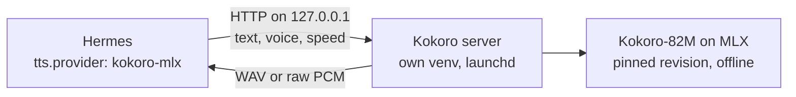

# hermes-kokoro-tts

Local [Kokoro](https://huggingface.co/hexgrad/Kokoro-82M) text-to-speech for [Hermes Agent](https://hermes-agent.nousresearch.com/docs/) on Apple Silicon. Hermes speaks with a natural voice in nine languages, sentence by sentence as the reply streams, and the text never leaves your Mac.

- **Native Hermes TTS provider**: set `tts.provider: kokoro-mlx` and every surface that speaks (Desktop read-aloud, voice mode, wake word, `text_to_speech`) uses it.
- **Streaming**: raw PCM per sentence, so the first words play while the rest of the reply is still being written.
- **Any Kokoro voice**: 54 voices in American and British English, Spanish, French, Hindi, Italian, Japanese, Brazilian Portuguese and Mandarin.
- **Isolated and offline**: the model runs in its own Python environment behind a loopback-only server. Hermes' own environment gets nothing new, and after installation nothing touches the network.
- **Pinned**: one reviewed model revision. Updating it is a code change you can see.

## Requirements

- macOS on Apple Silicon (MLX runs only there).
- Hermes Agent 0.22.2 or later (the version it is tested on).
- [`uv`](https://docs.astral.sh/uv/) (`brew install uv`). It also fetches Python 3.11 if you don't have it.
- About 1.5 GB of disk: ~1.1 GB of Python packages and ~340 MB of model.

## Install

```sh
hermes plugins install brunosouzas/hermes-kokoro-tts
hermes kokoro install                 # builds the server environment, downloads the model, starts it
hermes config set tts.provider kokoro-mlx
hermes kokoro say "Hello from Hermes"  # writes a test WAV and prints its path
```

`hermes kokoro install` is idempotent: run it again after an update or after changing the port.

**Upgrading from 0.1.0:** the provider is now called `kokoro-mlx` (it was `kokoro`). Hermes reserves the names of its built-in providers, and a built-in `kokoro` has been proposed upstream, so the plugin uses a name that cannot collide. Run `hermes config set tts.provider kokoro-mlx` once.

## Choose a voice

```sh
hermes kokoro voices                                            # what the installed model offers
hermes config set plugins.entries.kokoro-tts.settings.voice bf_emma
```

The first letter of a voice id is its language (`a` US English, `b` UK English, `e` Spanish, `f` French, `h` Hindi, `i` Italian, `j` Japanese, `p` Brazilian Portuguese, `z` Mandarin) and the second its gender. Some starting points: `af_heart`, `am_michael`, `bf_emma`, `bm_george`, `ef_dora`, `ff_siwis`, `if_sara`, `pf_dora`, `pm_alex`.

If `tts.voice` is set in your Hermes config, it wins over the plugin setting.

Each language loads its pronunciation pipeline the first time it is used after the server starts. The server does that at start-up for the configured voice, so run `hermes kokoro install` again after changing `voice`. Switching to another language later costs a one-off pause: a few seconds for most languages, up to about a minute for English, which loads spaCy and PyTorch.

Languages tested by the author: Brazilian Portuguese and English. The others come from Kokoro and use espeak-ng for pronunciation; Japanese and Mandarin may need extra G2P packages that this release does not install. Reports welcome.

## Settings

All under `plugins.entries.kokoro-tts.settings` (also editable in Hermes Desktop → Settings → Plugins):

| Key | Default | Meaning |
|---|---|---|
| `voice` | `af_heart` | Kokoro voice id |
| `language` | empty | Read text in another language with the same voice (`p`, `pt-br`, `e`, …). Empty = the voice's language |
| `speed` | `1.0` | 0.25 to 4.0 |
| `port` | `8770` | Loopback port of the server |
| `service_dir` | `~/Library/Application Support/hermes-kokoro-tts` | Server environment, model cache and log |

## Commands

| Command | What it does |
|---|---|
| `hermes kokoro install` | Create or refresh the environment, download the pinned model, install and start the launchd agent `dev.hermes.kokoro-tts` |
| `hermes kokoro status` | launchd state, server health, paths |
| `hermes kokoro restart` | Restart the server |
| `hermes kokoro voices` | List installed voices |
| `hermes kokoro say "text" [--voice id]` | Synthesize a test sentence to a WAV file |
| `hermes kokoro uninstall [--purge]` | Stop and remove the launchd agent; `--purge` also deletes the environment and the model |

## What it reads, sends and writes

- **Sends** the text Hermes wants spoken to `http://127.0.0.1:<port>`, on your own machine, bypassing any `http_proxy` setting. Nothing goes to a cloud service. The server does not log the text.
- **Downloads**, during `hermes kokoro install` only: Python packages through `uv` (PyPI, plus spaCy's `en_core_web_sm` 3.8.0 wheel from its GitHub release, pinned by SHA-256) and the model `mlx-community/Kokoro-82M-bf16` at revision `a71e4d38` from Hugging Face. The server then runs with `HF_HUB_OFFLINE=1`.
- **Writes** the server environment, model cache and log to `service_dir`, a launchd agent to `~/Library/LaunchAgents/dev.hermes.kokoro-tts.plist`, and the audio files Hermes asks for (WAV, 24 kHz mono).
- **Listens** only on loopback. The server refuses to bind any other address because it has no authentication.

## How it works



The server is a small standard-library HTTP server (`server/kokoro_server.py`) around `mlx-audio`. It loads the model once at start-up, serializes inference, and resolves each voice from the pinned snapshot on disk, which also sidesteps [mlx-audio#1041](https://github.com/Blaizzy/mlx-audio/issues/1041) (named voices fetched from another repository). It speaks an OpenAI-style `POST /v1/audio/speech` (`response_format` `wav` or `pcm`), so other local tools can use it too.

## Development

```sh
uv venv .venv --python 3.11
uv pip install --python .venv/bin/python "pytest>=8,<10" "numpy>=1.26,<3"
.venv/bin/python -m pytest -q
hermes plugins validate .
```

Tests use a fake model and stand-in HTTP servers, so they run anywhere; they import Hermes' `agent.tts_provider` from `HERMES_AGENT_REPO` (default `~/.hermes/hermes-agent`) when it is available.

## Licence

MIT. Kokoro-82M is Apache-2.0 ([hexgrad/Kokoro-82M](https://huggingface.co/hexgrad/Kokoro-82M)); the MLX conversion is [mlx-community/Kokoro-82M-bf16](https://huggingface.co/mlx-community/Kokoro-82M-bf16); inference uses [mlx-audio](https://github.com/Blaizzy/mlx-audio) (MIT).
